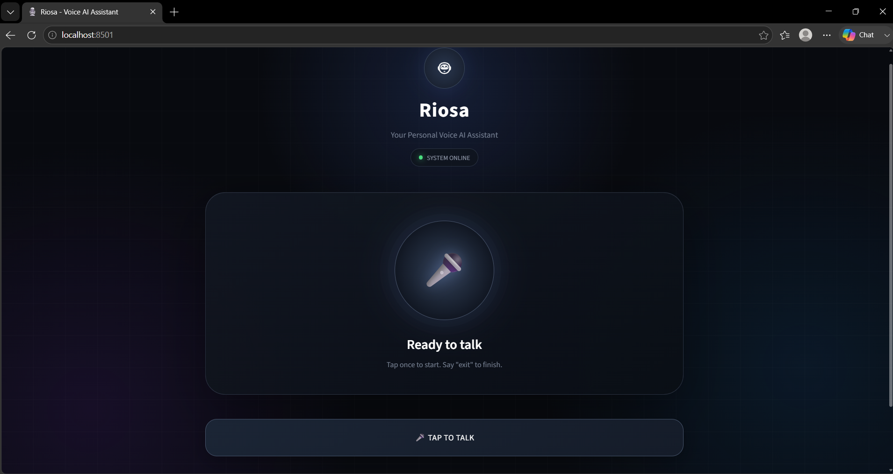

# 🤖 Riosa - Interactive Voice & Text AI Assistant

Riosa is an interactive AI assistant built with Python and Google Gemini. It seamlessly supports both **Voice** (microphone input & text-to-speech) and **Text** interaction across both an interactive **Terminal / CLI** and a modern **Streamlit Web Application**.

---

## 📸 Interface Preview



---

## 🚀 Key Features

- **🎙️ Dual Interactive Modality**:
  - **Voice Mode**: Speak into your microphone; Riosa listens, understands, and replies via text-to-speech.
  - **Text Chat**: Type questions directly in the Streamlit web chat or Terminal CLI.
  - **Hands-Free Continuous Mode**: Speak naturally without needing to press keys between turns.
- **🧠 Google Gemini Intelligence**: Powered by Google's Gemini models (`gemini-3.5-flash-lite`, `gemini-flash-latest`) for fast, natural conversational responses.
- **💬 Conversational Memory**: Remembers context across multi-turn interactions.
- **🔊 Spoken Voice Responses**: Built-in Text-to-Speech (TTS) engine using `pyttsx3` with adjustable speed and mute toggle.
- **🖥️ Futuristic Web UI (Streamlit)**:
  - Cyberpunk dark glowing theme with real-time animated status (Listening / Thinking / Speaking / Ready).
  - Built-in text chat input (`st.chat_input`) alongside the Voice Talk button.
  - Quick prompt recommendation buttons to get started with one click.
  - Sidebar settings to mute voice responses, adjust speech rate, view microphone/model status, and clear history.
- **⚡ Windows Console Unicode Safe**: Configured for UTF-8 compatibility to prevent emoji and character encoding issues.

---

## 🔄 Architecture & Flow

```text
       ┌───────────────────────────────┐
       │   User Input (Voice / Text)   │
       └──────────────┬────────────────┘
                      │
        ┌─────────────┴─────────────┐
        ▼                           ▼
  [Microphone]                [Keyboard]
        │                           │
        ▼                           │
 [Speech-to-Text]                   │
        │                           │
        └─────────────┬─────────────┘
                      │
                      ▼
            [Google Gemini API]
                      │
                      ▼
              [AI Response Text]
                      │
        ┌─────────────┴─────────────┐
        ▼                           ▼
  [Spoken Audio (TTS)]       [UI / Terminal Display]
```

---

## 📁 Project Structure

```text
voice-ai-assistant/
├── app/
│   ├── main.py              # Interactive Terminal / CLI assistant
│   ├── streamlit_app.py     # Futuristic Streamlit Web UI
│   ├── llm.py               # Gemini API client & memory management
│   ├── speech_to_text.py    # Microphone listening & transcription
│   ├── text_to_speech.py    # pyttsx3 voice output engine
│   └── voice_engine.py      # Background voice & text event loop
├── screenshots/
│   └── riosa-ui.png         # Web UI screenshot
├── .env                     # API key configuration (kept private)
├── .gitignore               # Ignored files (venv, .env, cache)
├── requirements.txt         # Python package dependencies
└── README.md                # Documentation & instructions
```

---

## 🛠️ Installation & Setup

### 1. Clone the Repository
```bash
git clone https://github.com/sagnikabhol/riosa-voice-ai.git
cd riosa-voice-ai
```

### 2. Set Up Virtual Environment
```bash
# Windows
python -m venv venv
.\venv\Scripts\activate

# macOS / Linux
python3 -m venv venv
source venv/bin/activate
```

### 3. Install Dependencies
```bash
pip install -r requirements.txt
```

### 4. Configure Your Gemini API Key
Create a `.env` file in the project root:
```env
GEMINI_API_KEY="your_google_gemini_api_key_here"
# Optional custom model:
# GEMINI_MODEL="gemini-3.5-flash-lite"
```

---

## 🎯 How to Run

### Option A: Modern Web UI (Recommended)
Launch the Streamlit web dashboard:
```bash
streamlit run app/streamlit_app.py
```
Open your browser at `http://localhost:8501`. You can:
- Click **"TAP TO TALK"** for microphone speech recognition.
- Or type any question into the chat bar at the bottom.
- Toggle voice responses, adjust speech rate, and clear history in the sidebar.

### Option B: Interactive Terminal Assistant
Launch the command-line interface:
```bash
python app/main.py
```
Interactive commands in the terminal:
- **Type any question** and press Enter to chat.
- **Press Enter** on an empty prompt (or type `mic`) to speak into the microphone.
- Type `loop` for hands-free continuous voice conversation.
- Type `mute` or `unmute` to toggle audio output.
- Type `clear` to reset conversation context.
- Type `exit` or `quit` to leave.

---

## 📜 Requirements

- Python 3.10+
- `google-genai`
- `SpeechRecognition`
- `PyAudio`
- `pyttsx3`
- `streamlit`
- `python-dotenv`

---

## 📄 License
This project is open source and available under the MIT License.
